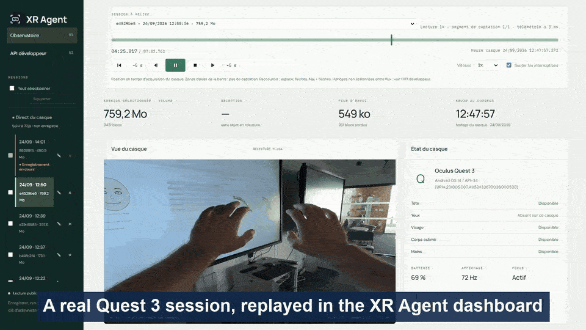

[English](README.md) · **Français**

# Perception Lab

**Un casque Meta Quest qui sert de capteur : sa caméra, son micro et les mouvements du corps sont enregistrés sur un serveur et relus dans un tableau de bord, pour donner des données réelles à la mémoire d'un agent d'IA.**

Version française

*Enregistrée sur un Quest 3 le 24 septembre 2026.*

## Ce qu'on fait avec

- **Captation.** Le module XR Agent, dans une application VR Unity, envoie la caméra extérieure du casque (passthrough, Quest 3) ou son écran (Quest Pro), le micro, la tête, les mains et le corps ; le regard et le visage sur Quest Pro, les expressions du visage déduites de la voix sur Quest 3.
- **Direct.** Le tableau de bord suit un casque à la fréquence du casque (72 par seconde sur Quest 3), avec environ 1,9 s de retard sur la vidéo.
- **Enregistrement.** Lancé et arrêté depuis le tableau de bord ; le serveur garde de 1 à 30 mesures et images par seconde, le direct restant complet.
- **Relecture.** Lecture, pas à pas image par image, barre de temps et vitesse ; chaque session s'exporte en archive décrite par son README, et une API sert les blocs de données bruts.
- **Dans d'autres applis.** HITeC, l'application de formation VR de l'école, embarque le module dans ses versions de test depuis novembre 2026, vidéo coupée : enregistrement lancé à distance et bouton de retour. Le tableau de bord s'ouvre aussi par casque dans QuestFleet, le gestionnaire de casques.
- **Mémoire (pas encore reliée).** Un service à part fait décrire une image toutes les 2 s par un modèle de vision et la verse dans un graphe de connaissances horodaté.

## Architecture

Diagramme en français

## État

- **En service** sur le serveur de l'école depuis septembre 2026 ; données sur un volume plafonné à 25 Go.
- **Mesuré en septembre 2026.** Premier enregistrement sur Quest 3 : 30 s, 592 blocs, aucune perte. Compression sans perte des données de suivi : 4,6 Go ramenés à 0,73 Go.
- **Casques.** L'appli a été diffusée sur neuf casques de test par la console de gestion de Meta (HMS), installation confirmée sur trois.
- **Service de mémoire** déployé en juillet 2026, 7 tests sur 7 au vert.
- **Pile technique.** Unity 6, Meta XR Core SDK, OpenXR ; module Android en Java (Camera2, MediaProjection) ; Node.js, WebSocket, ffmpeg, brotli ; FastAPI, Graphiti, FalkorDB, Groq ; Docker. Tableau de bord en français.

---

**Anthony Hunt** · [ingevision.cloud](https://ingevision.cloud/?p=xr-agent) · [LinkedIn](https://www.linkedin.com/in/anthony-hunt-3948a9196) · [GitHub](https://github.com/anthohunt)

Le code est privé.
