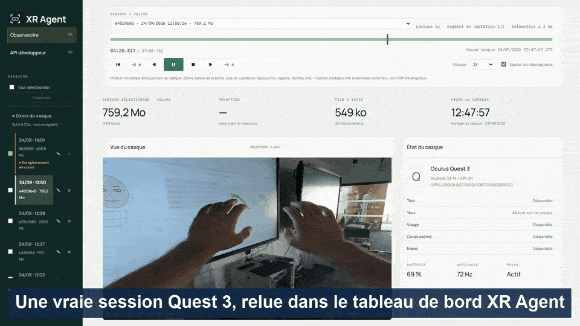

[English](README.md) · **Français**

# Perception Lab

**Un casque Meta Quest qui sert de capteur : sa caméra, son micro, la tête, les mains et le visage sont enregistrés sur un serveur et relus dans un tableau de bord, comme données réelles pour la mémoire d'un agent.**

*Le vrai tableau de bord relit une session enregistrée sur un Quest 3 le 24 septembre 2026. [Vidéo complète (0:51)](https://drive.google.com/file/d/150wWVXfFiRMC0FyEXY2cNvo6CEBMar6s/view)*

## Ce qu'on fait avec

- **Captation.** Un module Unity, dans l'application VR, envoie la caméra passthrough (Quest 3) ou l'écran (Quest Pro), le micro, la tête, les mains, le corps, le regard et le visage.
- **Direct.** Le tableau de bord suit un casque à sa propre fréquence, 72 mesures par seconde, avec la vidéo à environ 1,9 s.
- **Enregistrement.** Lancé et arrêté depuis le tableau de bord ; le serveur garde de 1 à 30 mesures et images par seconde, le direct restant complet.
- **Relecture.** Lecture, pas à pas image par image, barre de temps et vitesse ; chaque session s'exporte en archive décrite par son README, et une API sert les blocs bruts.
- **Dans d'autres applis.** L'application de formation HITeC embarque le module dans ses versions de test : enregistrement lancé à distance et bouton de retour. Le tableau de bord s'ouvre aussi par casque dans QuestFleet.
- **Mémoire.** Un service à part fait décrire une image toutes les 2 s par un modèle de vision et la verse dans un graphe de connaissances horodaté.

## Architecture

## État

- **En service** sur le serveur de l'école depuis septembre 2026, derrière son proxy ; données sur un volume plafonné à 25 Go.
- **Mesuré en septembre 2026.** Premier enregistrement sur Quest 3 : 30 s, 592 blocs, aucune perte. Compression sans perte : 4,6 Go ramenés à 0,73 Go.
- **Casques.** L'appli a été diffusée par HMS sur neuf casques de test, installation confirmée sur trois. Depuis novembre 2026, le module tourne dans les versions de test de HITeC, vidéo coupée.
- **Service de mémoire** déployé en juillet 2026, 7 tests sur 7 au vert ; la captation n'y est pas encore reliée.
- **Pile technique.** Unity 6, Meta XR Core SDK, OpenXR ; module Android en Java (Camera2, MediaProjection) ; Node.js, WebSocket, ffmpeg, brotli ; FastAPI, Graphiti, FalkorDB, Groq ; Docker. Tableau de bord en français.

---

**Anthony Hunt** · [ingevision.cloud](https://ingevision.cloud/?p=xr-agent) · [LinkedIn](https://www.linkedin.com/in/anthony-hunt-3948a9196) · [GitHub](https://github.com/anthohunt)

Le code est privé.
