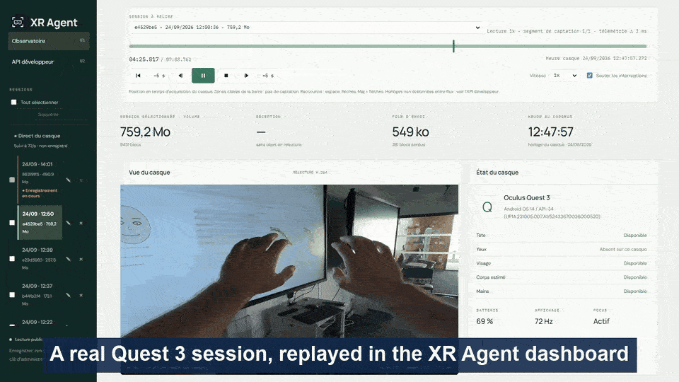

**English** · [Français](README.fr.md)

# Perception Lab

**A Meta Quest headset used as a sensor: its camera, microphone, head, hands and face are recorded on a server and replayed in a dashboard, as real data for an agent's memory.**

*The real dashboard replaying a session recorded on a Quest 3 on 24 September 2026. [Full video (0:51)](https://drive.google.com/file/d/160QcgVaUeIeIJBzmruf7TbSt0qzEYZ25/view)*

## Using it

- **Capture.** A Unity module inside the VR app sends the passthrough camera (Quest 3) or the screen (Quest Pro), the microphone, head, hands, body, gaze and face.
- **Live view.** The dashboard follows a headset at its own rate, 72 samples per second, with the video about 1.9 s behind.
- **Recording.** Started and stopped from the dashboard; the server keeps 1 to 30 samples and video frames per second, while the live view stays complete.
- **Replay.** Play, frame-by-frame steps, scrubbing and speed; each session exports as an archive described by its README, and an API serves the raw blocks.
- **In other apps.** The HITeC training app carries the module in its test builds: recordings started remotely and a feedback button. The dashboard also opens per headset inside QuestFleet.
- **Memory.** A separate service has a vision model describe one frame every 2 s and adds it to a time-stamped knowledge graph.

## Architecture

## Status

- **Running** on the school's server since September 2026, behind its proxy; data on a volume capped at 25 GB.
- **Measured in September 2026.** First Quest 3 recording: 30 s, 592 blocks, no loss. Lossless compression: 4.6 GB down to 0.73 GB.
- **Headsets.** The app went to nine test headsets through HMS, installation confirmed on three. Since November 2026 the module runs in HITeC test builds, with video off.
- **Memory service** deployed in July 2026, 7 out of 7 tests passing; capture is not yet wired to it.
- **Stack.** Unity 6, Meta XR Core SDK, OpenXR; Android module in Java (Camera2, MediaProjection); Node.js, WebSocket, ffmpeg, brotli; FastAPI, Graphiti, FalkorDB, Groq; Docker. Dashboard in French.

---

**Anthony Hunt** · [ingevision.cloud](https://ingevision.cloud/?lang=en&p=xr-agent) · [LinkedIn](https://www.linkedin.com/in/anthony-hunt-3948a9196) · [GitHub](https://github.com/anthohunt)

The code is private.
